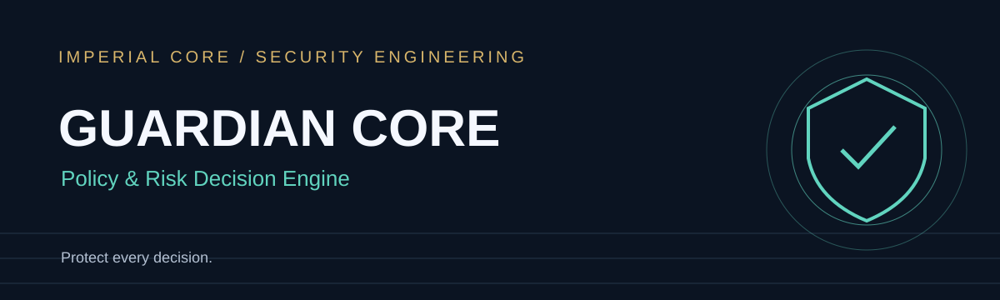

<p align="center"></p>

# GUARDIAN CORE

**Policy & Risk Decision Engine · IMPERIAL Core**

*Protect every decision.*

A pure deterministic decision function with explicit deny precedence, scoped veto snapshots, organization isolation and approval requirements.

**Status: REFERENCE IMPLEMENTATION / VERIFICATION PENDING.** No production deployment, certification or real Owner enrollment is claimed.

## Quick start

Node.js 22+; no external dependencies or paid services.

```sh
npm test
```

API: `evaluate(request, trustedPolicy, trustedVeto, now)`.

- [Architecture and release gates](ARCHITECTURE.md)
- [Threat model](THREAT_MODEL.md)
- [Security policy](SECURITY.md)
- [Source](src/index.mjs) · [Tests](test/reference.test.mjs)
- [Authorship](AUTHORS.md) · [Roadmap](ROADMAP.md)

## Limitations

Inputs must be authenticated by a trusted caller; no signed policy distribution, verified identity integration, risk telemetry or remote enforcement is deployed.

## Related components

[ZERO TRUST](https://github.com/oromaskevic23-cmd/ZERO-TRUST) · [GUARDIAN CORE](https://github.com/oromaskevic23-cmd/GUARDIAN-CORE) · [APPROVAL GATEWAY](https://github.com/oromaskevic23-cmd/APPROVAL-GATEWAY) · [AUDIT LEDGER](https://github.com/oromaskevic23-cmd/AUDIT-LEDGER) · [CYBER HAK](https://github.com/oromaskevic23-cmd/CYBER-HAK-Public)

## Founder and authorship

<p align="center"></p>

**Alexander Nikolaevich Romaskevich (RomaskevicH)** — Founder • Owner • CEO, IMPERIAL Core. Architect / Final Architectural Decision Authority.

Public source visibility is not a license grant. See [LICENSE](LICENSE).

**Architecture Before Implementation. Evidence Before Trust.**
